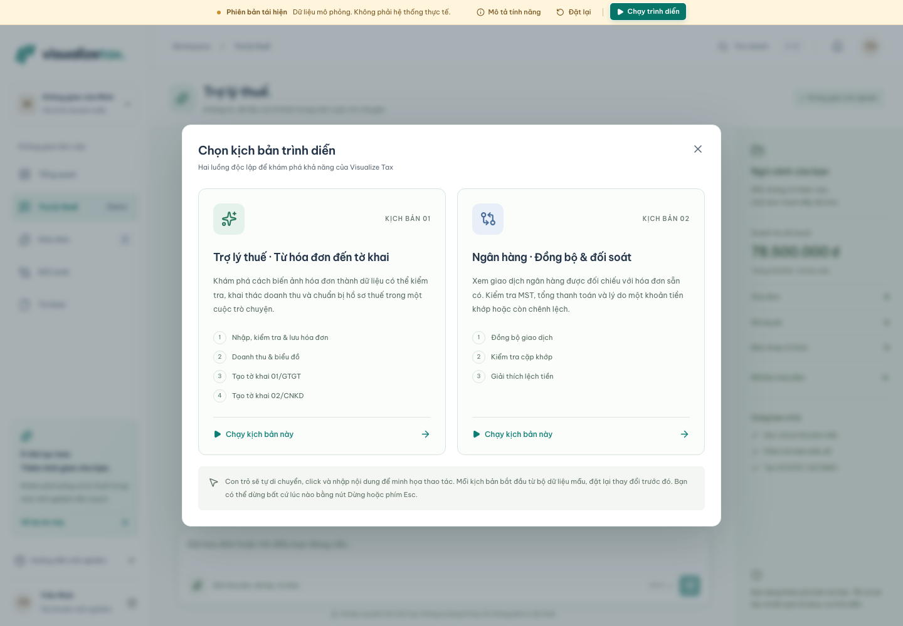
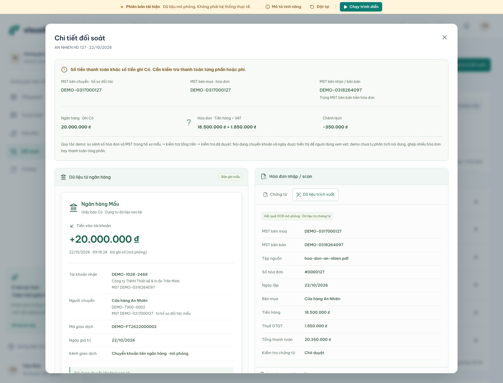
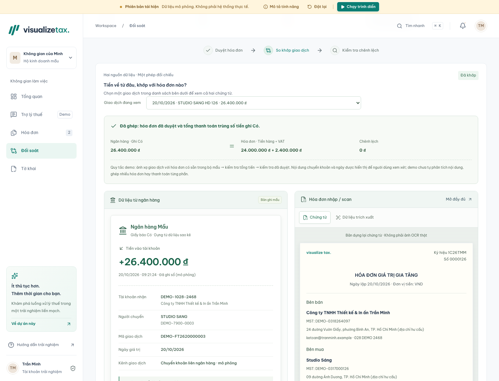
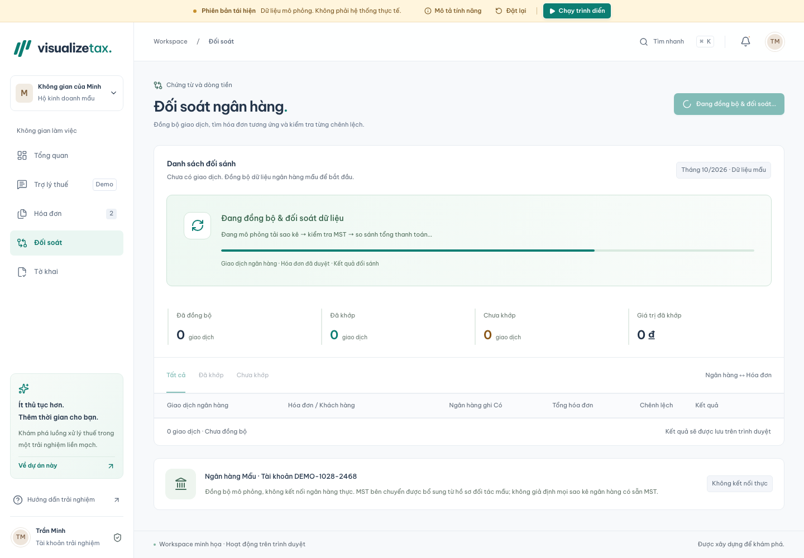

# Visualize Tax · Từ hóa đơn đến tờ khai 🧾

> **Một workspace tiếng Việt kết nối chứng từ, doanh thu và đối soát trong cùng trải nghiệm — khám phá dữ liệu qua hội thoại, kiểm tra khoản chênh lệch bằng hai nguồn và theo dõi toàn bộ quy trình qua trình diễn tương tác.**

**Dự án của Toàn Nguyễn** · Thiết kế trải nghiệm sản phẩm · Phát triển giao diện tương tác

[Khám phá demo](https://visualize-tax.vercel.app) · [Tính năng nổi bật](#features) · [Tài liệu kỹ thuật & cài đặt](TECHNICAL.md)

_Ảnh giao diện có sẵn trong repo; số liệu minh họa phản ánh trạng thái tại thời điểm chụp. [Nguồn ảnh](docs/SOURCES.md)._

**Phiên bản tái hiện độc lập dành cho portfolio.** Dữ liệu, trích xuất hóa đơn, phản hồi trợ lý, giao dịch ngân hàng và tờ khai đều là mô phỏng; không có AI hoặc kết nối ngân hàng thực tế. Mẫu in không có giá trị pháp lý.

---

## 🌟 Trải Nghiệm Trực Tuyến (Live Website)

**[Mở Visualize Tax ↗](https://visualize-tax.vercel.app)** · Không cần đăng nhập.

Chọn **Chạy trình diễn** trên banner để xem một trong hai kịch bản độc lập:

1. **Trợ lý thuế:** ảnh hóa đơn → kiểm tra và lưu → doanh thu kèm biểu đồ → xem trước hai bản nháp tờ khai.
2. **Đồng bộ & đối soát:** tải giao dịch mẫu → xem cặp khớp → kiểm tra cặp lệch tiền và hai chứng từ nguồn.

Dùng **Dừng / Esc** để trở lại thao tác thủ công; **Đặt lại** để bắt đầu lại với dữ liệu mẫu.

---

## 📌 Executive Summary (Tổng quan dự án)

| Thông số               | Chi tiết                                                                                                           |
| :--------------------- | :----------------------------------------------------------------------------------------------------------------- |
| **Project Name**       | **Visualize Tax**                                                                                                  |
| **Project Type**       | Sản phẩm mẫu tương tác dành cho portfolio, tái hiện độc lập luồng quản lý thuế                                     |
| **Đối tượng sử dụng**  | Người xem portfolio, nhà tuyển dụng và lập trình viên muốn khám phá trải nghiệm quản lý chứng từ cho hộ kinh doanh |
| **Phạm vi phát triển** | Năm màn hình liên thông: Tổng quan, Hóa đơn, Đối soát, Tờ khai và Trợ lý thuế                                      |
| **Trạng thái**         | Có demo trực tuyến và hai kịch bản trình diễn; toàn bộ nghiệp vụ dùng dữ liệu hư cấu                               |

---

## 🎯 Problem & Solution (Bài toán & Giải pháp)

- **Problem:** Chứng từ, doanh thu và giao dịch ngân hàng nằm ở nhiều ngữ cảnh. Người dùng cần biết số liệu đến từ đâu, hóa đơn nào cần kiểm tra và vì sao một khoản thanh toán chưa khớp.
- **Solution:** Kết nối các bước trong một workspace: duyệt hóa đơn, xem doanh thu, đối chiếu hai nguồn và chuẩn bị bản nháp tờ khai. Hội thoại có biểu đồ và chứng từ giúp khám phá dữ liệu; trình diễn tự động giúp người xem nắm được quy trình mà không cần hướng dẫn riêng.

---

## ✨ Key Features (Tính năng nổi bật)

| Tính năng                        | Giá trị mang lại                                                                                                         |
| :------------------------------- | :----------------------------------------------------------------------------------------------------------------------- |
| **🧾 Hóa đơn có thể kiểm tra**   | Tìm kiếm, lọc, xem từng dòng hàng và duyệt chứng từ trước khi đưa vào tổng hợp                                           |
| **💬 Hội thoại gắn với dữ liệu** | Trải nghiệm đính kèm hóa đơn mẫu, kiểm tra/lưu, xem doanh thu bằng biểu đồ và mở bản nháp ngay trong hội thoại           |
| **🔎 Đối soát hai nguồn**        | Đặt bản ghi ngân hàng cạnh hóa đơn, chỉ rõ mã số thuế, tổng tiền và khoản chênh lệch cần xem xét                         |
| **📄 Tờ khai có nguồn số liệu**  | Xem trước bản nháp minh họa, mở hóa đơn nguồn và in/lưu PDF từ trình duyệt                                               |
| **▶️ Trình diễn tương tác**      | Hai kịch bản tự thao tác qua từng bước, có tiến độ, con trỏ minh họa và khả năng dừng bất kỳ lúc nào                     |
| **📱 Trải nghiệm liền mạch**     | Giao diện tiếng Việt trên desktop/mobile, tìm nhanh, thao tác bàn phím và khôi phục phiên làm việc trên cùng trình duyệt |

### 💬 Từ chứng từ đến biểu đồ trong cùng hội thoại

Trợ lý mô phỏng đưa kết quả vào các thẻ có thể thao tác: kiểm tra hóa đơn, lưu vào workspace và xem doanh thu từ hóa đơn đã duyệt. Người xem có thể đi tiếp sang tờ khai mà vẫn giữ ngữ cảnh.

### 🔎 Khoản chênh lệch có thể giải thích

Sau khi đồng bộ dữ liệu mẫu, mở từng dòng để đối chiếu bản ghi ngân hàng và hóa đơn. Ví dụ bên dưới cho thấy khoản thiếu **350.000 đồng**; đây là tình huống hư cấu để thể hiện trải nghiệm kiểm tra sai lệch.

📷 Xem thêm bảng kết quả và trạng thái đồng bộ

---

## 👨‍💻 Competencies & Contributions (Năng lực & Đóng góp)

Các năng lực thể hiện qua sản phẩm:

- **Tư duy sản phẩm:** kết nối hóa đơn, đối soát và tờ khai thành luồng có thể trải nghiệm xuyên suốt, thay vì các màn hình rời rạc.
- **Thiết kế thông tin:** đưa chứng từ nguồn, chỉ số và lý do sai lệch vào đúng ngữ cảnh để người dùng tự kiểm tra kết quả.
- **Thiết kế tương tác:** xây dựng hội thoại có thẻ kết quả, trạng thái chờ, trình diễn có thể dừng và thao tác bàn phím.
- **Chú trọng chất lượng:** xử lý phiên làm việc, đặt lại dữ liệu, kích thước màn hình và khả năng tiếp cận; bằng chứng kiểm tra nằm trong [tài liệu kỹ thuật](TECHNICAL.md#highlights).

---

## 📈 Future Roadmap (Hướng phát triển)

Các hướng đề xuất cho phiên bản portfolio tiếp theo:

- [ ] Bổ sung kịch bản thanh toán từng phần và nhiều giao dịch cho một hóa đơn.
- [ ] Mở rộng hướng dẫn theo ngữ cảnh cho người dùng lần đầu.
- [ ] Thêm bộ dữ liệu hư cấu đa dạng để so sánh nhiều tình huống xử lý chứng từ.

---

## 👤 Author & Contact

- **Tác giả:** Toàn Nguyễn
- **GitHub:** [@nhttoan0809](https://github.com/nhttoan0809)
- **Ccùng tác giả:** [@toanb1805926](https://github.com/toanb1805926), [@toannguyen-ailogy](https://github.com/toannguyen-ailogy)

---

## 📄 License

Xem [thông tin giấy phép và tài nguyên bên thứ ba](TECHNICAL.md#license).
