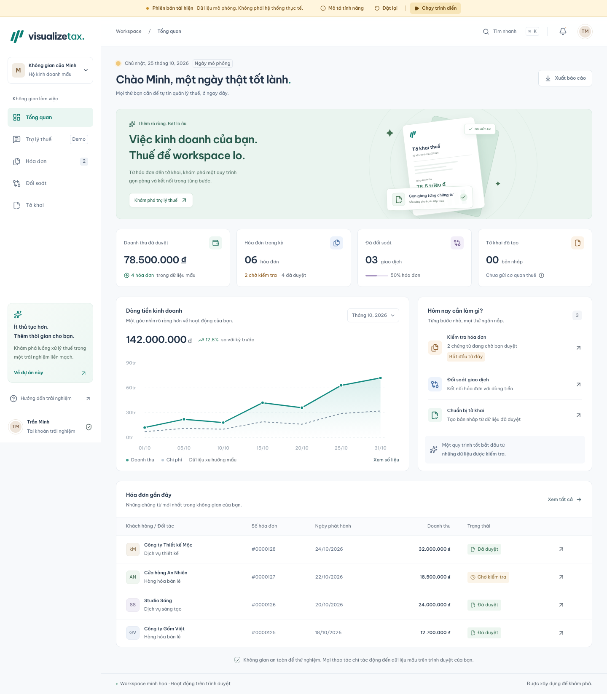
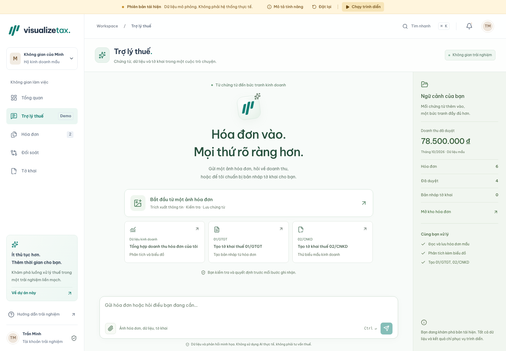
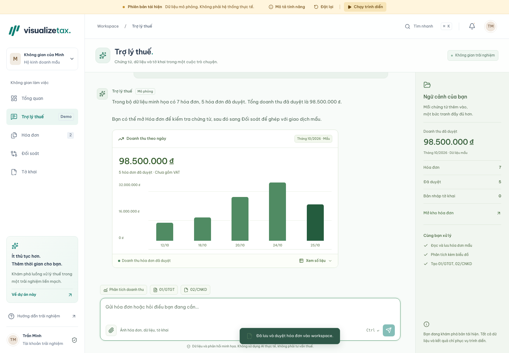

# Visualize Tax

Workspace quản lý thuế bằng tiếng Việt, được xây dựng độc lập từ các luồng nghiệp vụ của `original-tax` để thể hiện năng lực UI/UX và phát triển tính năng. Repo gốc chỉ được đọc tham khảo và không bị thay đổi.

**Đây là phiên bản tái hiện cho portfolio. Tất cả dữ liệu, phản hồi trợ lý, kết quả trích xuất và tờ khai đều là mô phỏng.**



## Chạy dự án

Yêu cầu Node.js 22 trở lên và pnpm 10.26.2. Project không cần biến môi trường hay backend.

```sh
pnpm install --frozen-lockfile
pnpm dev
```

Mở [localhost:3000](http://localhost:3000). Build production:

```sh
pnpm build
pnpm start
```

## Trải nghiệm chính

| Màn hình                     | Tính năng                                                                                                                  |
| ---------------------------- | -------------------------------------------------------------------------------------------------------------------------- |
| `/` — Tổng quan              | Chỉ số từ trạng thái hiện tại, biểu đồ mẫu có đổi kỳ/xem bảng số liệu, hóa đơn gần đây, xuất CSV                           |
| `/invoices` — Hóa đơn        | Tìm kiếm, lọc, sắp xếp, kéo thả/chọn file, trích xuất mẫu, xem chi tiết và duyệt                                           |
| `/reconciliation` — Đối soát | Ghép hóa đơn đã duyệt với giao dịch mẫu theo tổng thanh toán; lọc đã khớp/chưa khớp                                        |
| `/declarations` — Tờ khai    | Chọn 01/GTGT, 01/CNKD hoặc 02/CNKD, chọn kỳ mẫu và thuế suất minh họa, tạo bản nháp, xem trước và in/lưu PDF               |
| `/assistant` — Trợ lý thuế   | Workspace toàn chiều cao, đính kèm ảnh hóa đơn mẫu, lưu chứng từ, phản hồi có biểu đồ và tạo bản nháp ngay trong hội thoại |

Banner cố định ở mọi trang gồm:

- **Đặt lại:** khôi phục seed, xóa hội thoại/bản nháp, hủy thao tác đang xử lý và đưa về tổng quan. Không xóa dữ liệu của ứng dụng khác.
- **Mô tả tính năng:** trình bày bài toán quản lý hóa đơn, đối chiếu dòng tiền, phân tích và hỗ trợ kê khai; phân biệt định hướng nghiệp vụ với các tích hợp đang được mô phỏng.
- **Chạy trình diễn:** bắt đầu từ seed và chạy năm tình huống: bốn tình huống trong Trợ lý thuế gồm đính kèm ảnh → trích xuất → mở chi tiết từng mặt hàng → lưu hóa đơn; hỏi doanh thu kèm biểu đồ; tạo và mở 01/GTGT, kiểm tra hóa đơn nguồn; tạo và mở 02/CNKD (tham khảo 02/CNKD-TMĐT); tiếp theo đồng bộ ngân hàng và mở popup so sánh một cặp khớp, một cặp lệch tiền. Con trỏ minh họa di chuyển giữa các điều khiển, click, gõ từng ký tự và gửi bằng `Ctrl + Enter`. Thao tác gọi chính các handler của giao diện; đây là mô phỏng trong trang web, không điều khiển chuột hệ điều hành. Vùng ứng dụng tạm khóa tương tác; nút dừng và phím Escape luôn hoạt động. Dữ liệu đã hoàn tất được giữ lại khi dừng.

Tìm nhanh bằng nút trên thanh đầu trang hoặc `⌘ K` / `Ctrl K`. Menu mobile hỗ trợ bàn phím và Escape. Các animation tôn trọng `prefers-reduced-motion`. Trong Trợ lý, `Alt + I` mở đính kèm; `Enter` hoặc `Ctrl + Enter` gửi tin, `Shift + Enter` xuống dòng.





## Dữ liệu và giới hạn

- Seed hoàn toàn hư cấu ở `src/lib/demo-data.ts`; kỳ tháng 10/2026 là bối cảnh mô phỏng cố định.
- Mock API là facade bất đồng bộ chạy trong trình duyệt, có độ trễ và hỗ trợ hủy; không có API nghiệp vụ máy chủ.
- Trạng thái được lưu với schema version tại key `visualize-tax:demo:v1`. Dữ liệu hỏng hoặc storage bị chặn sẽ dùng seed/in-memory.
- File người dùng chọn **chỉ cung cấp tên chứng từ**. Nội dung không được đọc hoặc gửi đi. Mọi lần trích xuất đều trả hóa đơn mẫu “Xưởng Giấy Nhỏ”; nhập lại sẽ thay bản mẫu này.
- Tổng quan lấy chỉ số từ trạng thái thực của demo. Biểu đồ dòng tiền ở Tổng quan là dữ liệu xu hướng riêng; biểu đồ trong Trợ lý được tính trực tiếp từ hóa đơn đã duyệt tại thời điểm trả lời và lưu cùng hội thoại.
- 01/GTGT mô phỏng thuế đầu ra trừ 2.800.000 đồng thuế đầu vào từ hai chứng từ mua vào giả lập. CNKD mô phỏng phân bổ tổng tỷ lệ thành GTGT và TNCN. Kịch bản hội thoại dùng 10% và 1,5%; không xác định mức thuế áp dụng thực tế. Các kỳ tờ khai dùng cùng bộ hóa đơn mẫu. Xem [nguồn biểu mẫu, giả định và phép tính](docs/FORM-REFERENCES.md).
- Nút **In / Lưu PDF** mở hộp thoại in của trình duyệt; mẫu in luôn có thông báo không có giá trị pháp lý.
- Không có đăng ký/đăng nhập, OTP, database, thanh toán, tích hợp ngân hàng hay model AI thật.

## Công nghệ và cấu trúc

Next.js App Router · React · TypeScript strict · Tailwind CSS v4/PostCSS · GSAP với `useGSAP` · Lucide · font Be Vietnam Pro tự host · Playwright và axe-core.

```text
src/app/                    Routes, layout, metadata, global styles
src/components/             Các màn hình, shell, provider và UI dùng chung
src/lib/                    Seed, mock API, persistence validation, export, hủy tác vụ
.agents/skills/ui-ux-pro-max Skill Codex ở phạm vi project
AGENTS.md                   Mục tiêu cuối cùng và giới hạn triển khai
design-system/             Quyết định thiết kế
docs/DEPLOYMENT.md          Trạng thái và quy trình triển khai qua MCP
tests/                     Kiểm thử hành vi bằng trình duyệt
```

Skill [UI/UX Pro Max](https://github.com/nextlevelbuilder/ui-ux-pro-max-skill) đã được cài tại `.agents/skills/ui-ux-pro-max`, pin theo revision ghi trong `PROVENANCE.md`, kèm license upstream. Codex nhận skill project từ lượt làm việc tiếp theo; không ghi đè bản global.

## Kiểm tra

Cài Chromium cho Playwright một lần:

```sh
pnpm exec playwright install --only-shell chromium
```

```sh
pnpm lint
pnpm typecheck
pnpm test:e2e
pnpm build
pnpm format:check
```

Bộ kiểm thử chạy trên desktop 1440 px và mobile 375 px, bao gồm luồng liên thông, persist sau reload, reset và hủy tác vụ, trình diễn hoàn tất/dừng/Escape, storage bị lỗi/bị chặn, kiểm tra file, responsive, sticky banner và kiểm tra accessibility tự động. Playwright dùng port 3002 và tự chạy dev server nếu chưa có. Báo cáo tạo ở `playwright-report/` (được gitignore). Nếu đã chạy dev server ở cổng khác, dùng đúng hostname đã khởi động:

```sh
PLAYWRIGHT_BASE_URL=http://localhost:3000 pnpm test:e2e
```

Biến này chỉ cấu hình URL kiểm thử và không yêu cầu một server thứ hai. Kiểm thử trình diễn chạy cả chuyển động/gõ ký tự bình thường và xác nhận đủ năm tình huống, gồm đồng bộ ngân hàng và kiểm tra cặp khớp/lệch tiền.

## GitHub và Vercel

Cấu hình Vercel đã sẵn sàng trong `vercel.json`, không cần secret. **Chưa push hoặc deploy** vì phiên làm việc chưa cung cấp công cụ MCP GitHub/Vercel. Xem [docs/DEPLOYMENT.md](docs/DEPLOYMENT.md) để tiếp tục đúng yêu cầu triển khai qua MCP khi hai server đã kết nối.

Màn Đối soát bắt đầu trống. Chọn **Đồng bộ & đối soát** để lưu snapshot giao dịch mẫu; bảng kết quả nằm ở đầu trang, click từng dòng mở popup kiểm tra hai nguồn: giấy báo Có/bản ghi ngân hàng mô phỏng và chứng từ hóa đơn dựng lại. Chuyển sang Dữ liệu trích xuất để đối chiếu từng trường; chọn giao dịch để xem lý do đã khớp hoặc lệch tiền. MST bên mua/bên chuyển và bên bán/bên nhận dùng chung định danh hư cấu; hai dòng lệch lần lượt 350.000 và 4.500.000 đồng. Đồng bộ lại không nhân bản giao dịch, reset xóa snapshot; dữ liệu lưu cũ chưa đồng bộ sẽ hiển thị danh sách trống.
