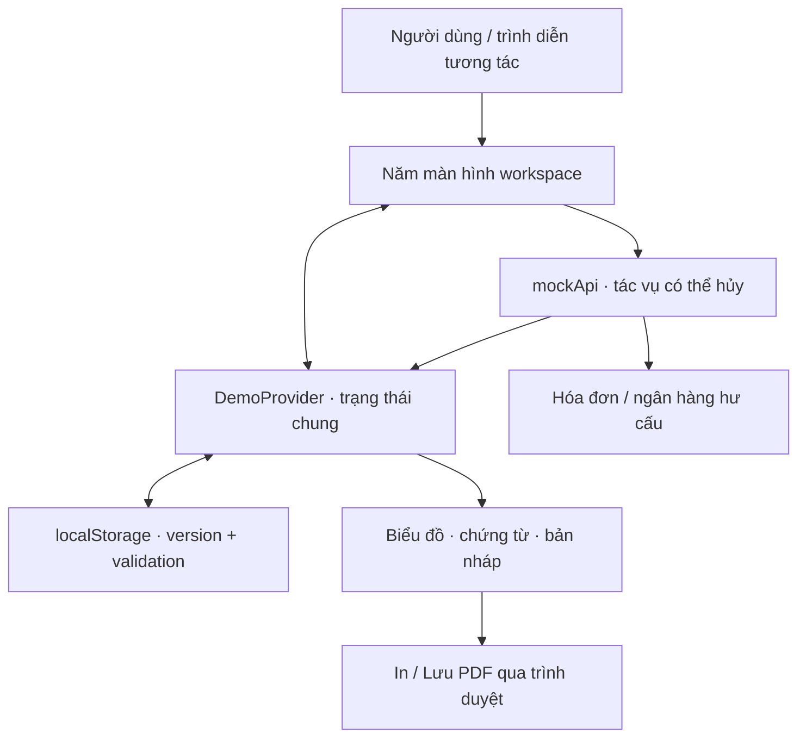

# Technical Guide · Visualize Tax

[Tổng quan dự án và năng lực thể hiện](README.md)

Tài liệu dành cho lập trình viên và agents: phạm vi triển khai, công nghệ, kiến trúc, cấu hình và kiểm tra.

[Phạm vi](#scope) · [Skills & Tech Stack](#stack) · [Kiến trúc & API](#architecture) · [Cài đặt](#setup) · [Điểm kỹ thuật](#highlights) · [Hướng cải thiện](#roadmap) · [Tham khảo](#references) · [Giấy phép](#license)

<a id="scope"></a>

## 📍 Implementation Scope (Phạm vi triển khai)

Phiên bản tái hiện độc lập cho portfolio, chạy bằng dữ liệu hư cấu trên trình duyệt. Nguồn tham khảo `original-tax` chỉ đọc; không cần cài, chạy hoặc cấu hình dự án gốc. Đọc [AGENTS.md](AGENTS.md) trước khi thay đổi phạm vi.

| Thành phần             | Trách nhiệm                                            | Trạng thái / Giới hạn                                                 |
| :--------------------- | :----------------------------------------------------- | :-------------------------------------------------------------------- |
| Workspace năm màn hình | Tổng quan, hóa đơn, đối soát, tờ khai, trợ lý          | Giao diện tương tác đã có                                             |
| Mock API               | Trích xuất, đồng bộ, tạo bản nháp, trả lời hội thoại   | Facade bất đồng bộ trong trình duyệt; không có dịch vụ nghiệp vụ thật |
| Persistence            | Lưu hóa đơn, hội thoại, bản nháp và snapshot ngân hàng | localStorage theo từng trình duyệt; không đồng bộ máy chủ             |
| Trình diễn             | Hai kịch bản thao tác qua handler UI                   | Có dừng/hủy và hỗ trợ reduced motion                                  |

### Dữ liệu và giới hạn

- Seed hoàn toàn hư cấu ở `src/lib/demo-data.ts`; kỳ tháng 10/2026 là bối cảnh mô phỏng cố định.
- Mock API là facade bất đồng bộ chạy trong trình duyệt, có độ trễ và hỗ trợ hủy; không có API nghiệp vụ máy chủ.
- Trạng thái được lưu với schema version tại key `visualize-tax:demo:v1`. Dữ liệu hỏng hoặc storage bị chặn sẽ dùng seed/in-memory.
- File người dùng chọn **chỉ cung cấp tên chứng từ**. Nội dung không được đọc hoặc gửi đi. Mọi lần trích xuất đều trả hóa đơn mẫu “Xưởng Giấy Nhỏ”; nhập lại sẽ thay bản mẫu này.
- Tổng quan lấy chỉ số từ trạng thái thực của demo. Biểu đồ dòng tiền ở Tổng quan là dữ liệu xu hướng riêng; biểu đồ trong Trợ lý được tính trực tiếp từ hóa đơn đã duyệt tại thời điểm trả lời và lưu cùng hội thoại.
- 01/GTGT mô phỏng thuế đầu ra trừ 2.800.000 đồng thuế đầu vào từ hai chứng từ mua vào giả lập. CNKD mô phỏng phân bổ tổng tỷ lệ thành GTGT và TNCN. Kịch bản hội thoại dùng 10% và 1,5%; không xác định mức thuế áp dụng thực tế. Các kỳ tờ khai dùng cùng bộ hóa đơn mẫu. Xem [nguồn biểu mẫu, giả định và phép tính](docs/FORM-REFERENCES.md).
- Nút **In / Lưu PDF** mở hộp thoại in của trình duyệt; mẫu in luôn có thông báo không có giá trị pháp lý.
- Không có đăng ký/đăng nhập, OTP, database, thanh toán, tích hợp ngân hàng hay model AI thật.

---

<a id="stack"></a>

## 🛠 Skills & Tech Stack (Kỹ năng & Công nghệ)

Phiên bản dưới đối chiếu từ [package.json](package.json); [pnpm-lock.yaml](pnpm-lock.yaml) cố định dependency được cài.

| Tầng / Nhóm   | Công nghệ và phiên bản khai báo                 | Vai trò                                      |
| :------------ | :---------------------------------------------- | :------------------------------------------- |
| Framework     | Next.js 16.4.3, React / React DOM 19.3.0        | App Router, routes và giao diện tương tác    |
| Ngôn ngữ      | TypeScript ^5, strict                           | Mô hình dữ liệu và kiểm tra kiểu             |
| Styling       | Tailwind CSS ^4, PostCSS adapter ^4.3.3         | Layout responsive và giao diện               |
| Motion        | GSAP ^3.15.0, @gsap/react ^2.1.2                | Animation và vòng đời chuyển động            |
| Tài nguyên UI | Lucide React ^1.61.0, Be Vietnam Pro ^5.3.0     | Icon và font tự host                         |
| Kiểm thử      | Playwright ^1.64.1, axe-core/playwright ^4.14.0 | Hành vi trình duyệt và accessibility tự động |
| Công cụ       | ESLint ^9, Prettier ^3.9.10, pnpm 10.26.2       | Chất lượng và cài đặt nhất quán              |

- **Kỹ năng thể hiện:** state management, mô hình artifact hội thoại, persistence có validation, cancellation, trình diễn qua UI, responsive và kiểm thử đầu cuối.
- **Skill hỗ trợ agents:** UI/UX Pro Max trong `.agents/skills/ui-ux-pro-max`; đây là công cụ hỗ trợ phát triển, không phải dependency runtime. Revision và giấy phép được ghi trong thư mục skill.

---

<a id="architecture"></a>

## 🏗 System Architecture & API Design (Kiến trúc & Thiết kế API)

### System Architecture



Không có API nghiệp vụ HTTP, database, xác thực, OCR, model AI hoặc ngân hàng thật. Next.js phục vụ các route giao diện; facade `mockApi` chạy phía client.

### Repository Structure

```text
visualize-tax/
├── README.md / TECHNICAL.md       Tổng quan và tài liệu kỹ thuật
├── src/app/                      Routes, metadata, CSS
├── src/components/               Màn hình, provider, chứng từ và UI
├── src/lib/                      Seed, mock API, export, trình diễn
├── tests/                        Playwright specs
├── docs/                         Ảnh, nguồn biểu mẫu, validation, deployment
├── design-system/                Quyết định thiết kế
└── .agents/skills/                Skill hỗ trợ agents
```

### API / Routes / Protocols

| Loại   | Route / Hàm                                            | Contract / Chức năng                                               |
| :----- | :----------------------------------------------------- | :----------------------------------------------------------------- |
| UI     | `/`                                                    | Chỉ số trạng thái, xu hướng mẫu, hóa đơn gần đây, CSV              |
| UI     | `/invoices`                                            | Tìm/lọc/sắp xếp, thêm chứng từ mẫu, xem và duyệt                   |
| UI     | `/reconciliation`                                      | Đồng bộ snapshot, xem bảng kết quả và popup hai nguồn              |
| UI     | `/declarations`                                        | Chọn mẫu/kỳ/tỷ lệ, tạo, xem và in bản nháp                         |
| UI     | `/assistant`                                           | Hội thoại, attachment mẫu, biểu đồ và tờ khai                      |
| Nội bộ | `mockApi.extractInvoice(source, signal?)`              | Tên chứng từ → hóa đơn mẫu sau độ trễ 1.600 ms                     |
| Nội bộ | `mockApi.syncAndReconcile(invoices, signal?)`          | Hóa đơn → snapshot giao dịch, thời gian và matchedIds sau 1.800 ms |
| Nội bộ | `mockApi.createDeclaration(input, signal?, invoices?)` | Form/kỳ/doanh thu/tỷ lệ → bản nháp có snapshot nguồn, sau 1.100 ms |
| Nội bộ | `mockApi.chat(question, invoices, signal?)`            | Câu hỏi → chuỗi trả lời theo kịch bản sau 1.100 ms                 |

Độ trễ là thông số mô phỏng, không phải benchmark. `AbortSignal` hủy tác vụ chờ; reset/dừng không được ghi kết quả muộn. `matchesBankInvoice` so số hóa đơn, MST hai bên, tổng thanh toán và trạng thái đã duyệt. Xem [demo-data.ts](src/lib/demo-data.ts).

---

<a id="setup"></a>

## 🚀 Getting Started (Cài đặt & Chạy thử)

### Prerequisites

- Node.js >=22.0.0 và pnpm 10.26.2 theo manifest.
- Không cần backend, tài khoản, API key hay biến môi trường để chạy ứng dụng.
- Quyền truy cập repository nếu clone khi repo vẫn private.

### Installation

**Thư mục thực hiện:** gốc `visualize-tax`.

```sh
git clone https://github.com/nhttoan0809/visualize-tax.git
cd visualize-tax
pnpm install --frozen-lockfile
```

### Configuration

Không có bước tạo `.env`. Dữ liệu mẫu nằm trong `src/lib/demo-data.ts` và `src/lib/document-data.ts`. Không đưa tài liệu khách hàng hoặc dữ liệu thật vào seed. Đọc [nguồn biểu mẫu](docs/FORM-REFERENCES.md) trước khi sửa phép tính.

### Development & Build

```sh
pnpm dev
```

Mở `http://localhost:3000`. Dừng dev server trước khi chạy production cùng port:

```sh
pnpm build
pnpm start
```

Chỉ có một ứng dụng cần chạy. `pnpm build` tạo artifact Next.js trong `.next/`.

---

<a id="highlights"></a>

## 🔍 Implementation Highlights (Điểm kỹ thuật & Module)

### Module Map

| Module / Đường dẫn                                    | Trách nhiệm                             | Điểm cần chú ý                                           |
| :---------------------------------------------------- | :-------------------------------------- | :------------------------------------------------------- |
| `src/lib/demo-data.ts`                                | Kiểu, seed, facade, validation, biểu đồ | Storage key `visualize-tax:demo:v1`, snapshot có version |
| `src/lib/document-data.ts`                            | Dòng hàng, định danh, dữ liệu chứng từ  | Hoàn toàn hư cấu; công thức chỉ minh họa                 |
| `src/components/demo-provider.tsx`                    | State, persist, reset, trình diễn       | Hủy tác vụ; chỉ xóa key của ứng dụng                     |
| `src/lib/presentation.ts`                             | Con trỏ, click, gõ và phím tắt          | Abort và thao tác qua handler UI                         |
| `src/lib/presentation-scenarios.ts`                   | Hai kịch bản độc lập                    | Trợ lý 4 bước, đối soát 3 bước                           |
| `src/components/assistant.tsx` / `chat-artifacts.tsx` | Hội thoại và kết quả tương tác          | Vùng cuộn riêng, composer bám đáy                        |
| `src/components/reconciliation-inspector.tsx`         | So sánh hai nguồn                       | Chứng từ, dữ liệu trích xuất và chênh lệch               |
| `src/components/declaration-document.tsx`             | Xem/in bản nháp                         | Nhãn minh họa và hóa đơn nguồn                           |
| `src/lib/export.ts`                                   | Xuất dữ liệu                            | CSV dành cho dữ liệu mẫu                                 |

### Technical Decisions & Limitations

- **Khôi phục an toàn:** localStorage có version, kiểm tra cấu trúc và fallback seed/in-memory nếu hỏng hoặc bị chặn. Workspace cũ không có snapshot ngân hàng giữ hóa đơn nhưng đối soát trống.
- **Tính nhất quán:** tờ khai và biểu đồ hội thoại lưu snapshot tại thời điểm tạo; đồng bộ lại thay snapshot thay vì nhân đôi giao dịch.
- **Trình diễn có thể ngắt:** chỉ reset khi chọn chạy kịch bản; `inert` và lớp chặn pointer hạn chế tương tác xung đột, giữ nút dừng và Escape hoạt động. Timer/request phải hủy khi reset, dừng hoặc unmount.
- **Trạng thái xử lý:** đồng bộ có spinner, thanh indeterminate và `aria-busy`; không dùng tỷ lệ phần trăm giả. Khóa nút lặp/bảng/bộ lọc trong lúc chờ.
- **Khả năng tiếp cận:** focus nhìn thấy, nhãn điều khiển, keyboard navigation và `prefers-reduced-motion`. Trợ lý hỗ trợ `Alt + I`, Enter/Ctrl + Enter và Shift + Enter; tìm nhanh dùng ⌘K/Ctrl K.
- **Giới hạn nghiệp vụ:** chưa mô hình hóa nhiều hóa đơn cho một khoản chuyển hoặc thanh toán từng phần. Không dùng công thức demo để xác định nghĩa vụ thuế.

### Verification

Cài Chromium cho Playwright một lần:

```sh
pnpm exec playwright install --only-shell chromium
```

```sh
pnpm lint
pnpm typecheck
pnpm test:e2e
pnpm build
pnpm format:check
```

Bộ kiểm thử chạy trên desktop 1440 px và mobile 375 px, bao gồm luồng liên thông, persist sau reload, reset và hủy tác vụ, trình diễn hoàn tất/dừng/Escape, storage bị lỗi/bị chặn, kiểm tra file, responsive, sticky banner và kiểm tra accessibility tự động. Playwright dùng port 3002 và tự chạy dev server nếu chưa có. Báo cáo tạo ở `playwright-report/` (được gitignore). Nếu đã chạy dev server ở cổng khác, dùng đúng hostname đã khởi động:

```sh
PLAYWRIGHT_BASE_URL=http://localhost:3000 pnpm test:e2e
```

Biến này chỉ cấu hình URL kiểm thử và không yêu cầu một server thứ hai. Kiểm thử trình diễn chạy cả chuyển động/gõ ký tự bình thường và xác nhận hai kịch bản chạy độc lập, không gọi nhầm luồng của nhau; có kiểm tra picker, focus và dừng khi đồng bộ đang loading.

**Bằng chứng có sẵn:** [docs/VALIDATION.md](docs/VALIDATION.md) ghi nhận 36/36 E2E, lint/typecheck/build và kiểm tra responsive ngày 28/10/2026; đây là báo cáo đã có trong repo, không phải kết quả được chạy lại khi biên tập tài liệu này. Thay đổi lần này chỉ liên quan Markdown, không thay mã ứng dụng.

### Deployment & Operations

Production: [visualize-tax.vercel.app](https://visualize-tax.vercel.app), triển khai ngày 28/10/2026 qua Vercel CLI. Repository: [nhttoan0809/visualize-tax](https://github.com/nhttoan0809/visualize-tax), nhánh `main`, private. GitHub được cập nhật qua Git/GitHub API vì MCP chưa kết nối. Chưa bật Git auto-deploy; cập nhật mã nguồn trên GitHub không tự triển khai Vercel. Xem [docs/DEPLOYMENT.md](docs/DEPLOYMENT.md) để biết deployment, commit ứng dụng và kết quả kiểm tra trên URL thật.

Màn Đối soát bắt đầu trống. Chọn **Đồng bộ & đối soát** để lưu snapshot giao dịch mẫu; bảng kết quả nằm ở đầu trang, click từng dòng mở popup kiểm tra hai nguồn: giấy báo Có/bản ghi ngân hàng mô phỏng và chứng từ hóa đơn dựng lại. Chuyển sang Dữ liệu trích xuất để đối chiếu từng trường; chọn giao dịch để xem lý do đã khớp hoặc lệch tiền. MST bên mua/bên chuyển và bên bán/bên nhận dùng chung định danh hư cấu; hai dòng lệch lần lượt 350.000 và 4.500.000 đồng. Đồng bộ lại không nhân bản giao dịch, reset xóa snapshot; dữ liệu lưu cũ chưa đồng bộ sẽ hiển thị danh sách trống.

Khi đồng bộ ngân hàng, nút và vùng kết quả có trạng thái busy, spinner và thanh loading indeterminate. Bộ lọc và bảng tạm khóa trong khi xử lý; không có tỷ lệ phần trăm tiến độ giả.

---

<a id="roadmap"></a>

## 📈 Learnings & Technical Roadmap (Bài học & Hướng cải thiện)

### Key Learnings

- Một demo có giá trị khi trạng thái liên thông và có thể truy nguyên chứng từ, không chỉ có màn hình đẹp.
- Trình diễn qua handler thật giúp phát hiện vấn đề focus, hủy tác vụ và đồng bộ UI mà việc gán kết quả trực tiếp có thể bỏ sót.
- Snapshot và validation giúp giữ kết quả hội thoại/tờ khai nhất quán khi nguồn dữ liệu thay đổi.

### Technical Roadmap

Các hạng mục đề xuất, chưa triển khai:

- [ ] Tách thuật toán ghép cặp để mở rộng kiểm thử thanh toán từng phần/nhiều chứng từ.
- [ ] Thêm visual regression cho chứng từ, bản in và các breakpoint.
- [ ] Thiết lập CI cho lint, typecheck, E2E và build; Git auto-deploy hiện chưa bật theo hồ sơ triển khai.

---

<a id="references"></a>

## 📚 References (Tài liệu liên quan)

- [AGENTS.md](AGENTS.md): mục tiêu, phạm vi, hướng dẫn agents.
- [package.json](package.json), [pnpm-lock.yaml](pnpm-lock.yaml), [Playwright config](playwright.config.ts): lệnh, dependency và môi trường test.
- [Nguồn biểu mẫu và giả định](docs/FORM-REFERENCES.md): phạm vi mô phỏng, cách tính và tài liệu đối chiếu.
- [Kết quả kiểm tra có sẵn](docs/VALIDATION.md) và [hồ sơ triển khai](docs/DEPLOYMENT.md).
- [Nguồn ảnh](docs/SOURCES.md) và [design system](design-system/visualize-tax/MASTER.md).
- [Template README](README_TEMPLATE.md) và [template kỹ thuật](TECHNICAL_TEMPLATE.md) để tái sử dụng format.

---

<a id="license"></a>

## 📄 License

Repo chưa có giấy phép cấp dự án được khai báo trong `package.json` hoặc file LICENSE ở gốc. Không mặc định cho phép tái sử dụng theo MIT.

Các dependency, font và tài nguyên bên thứ ba tuân theo giấy phép riêng. Skill UI/UX Pro Max có license và provenance upstream trong `.agents/skills/ui-ux-pro-max`. Ảnh trong README là ảnh giao diện demo với dữ liệu hư cấu; xem [nguồn ảnh](docs/SOURCES.md). Biểu mẫu/tờ khai minh họa không phải hồ sơ pháp lý chính thức.
